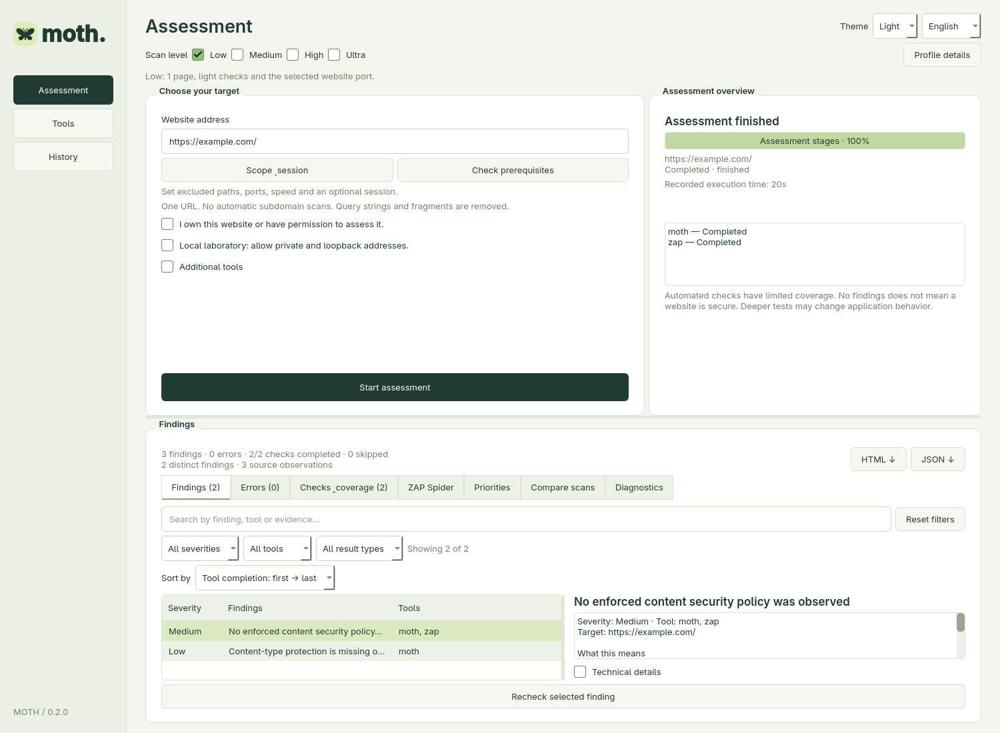

# Moth

Moth is a native desktop website security assessment program with optional scanner integrations, plain-language findings, technical details, and actionable recommendations.

**Version 0.2 — native Qt/PySide6 desktop application.** Moth opens its own window with native widgets, without a browser interface, Electron shell or embedded web view. English is the default language; Romanian and Russian are available from the language selector. ZAP uses an internal loopback control API when its integration is selected.



*Current desktop interface with demonstration findings for example.com; no live assessment is shown.*

## Current capabilities

| Area | Available now |
| --- | --- |
| Scan control | Low/Medium/High/Ultra profiles, per-tool progress, approximate remaining time, Stop and Skip current tool |
| Scope | Excluded path prefixes, custom Nmap TCP ports, independent web/Nmap rates |
| Authentication | One-assessment cookie, Bearer token or HTTP Basic sessions, with private-page verification |
| Findings | Grouped equivalent header observations, combined source evidence, filters and priority recommendations |
| History | Baseline comparison and targeted rechecks, with incomplete coverage kept visible |
| Preparation | CLI/dependency diagnostics, template preparation, installed-tool detection and queued installation/update actions |
| Reports | Local SQLite history and standalone HTML/JSON exports |

[Installation](#installation) · [Assessment workflow](#assessment-workflow) · [Authenticated assessments](#authenticated-assessments) · [Scan levels](#scan-levels) · [Development and packaging](#development-and-packaging) · [Roadmap](ROADMAP.md)

## Installation

Moth is a desktop application for Linux, Windows and macOS. Source installs require **Python 3.11 or newer**, Git and an internet connection for the first launch. Optional security tools are installed separately from the **Tools** page; you can start with the built-in checks alone.

### Download desktop installers

These preview downloads include Python and Qt for Moth. Optional scanners are managed separately in the app.

| Platform | Direct download | Install |
| --- | --- | --- |
| Windows 10/11 x64 | [Windows Setup (.exe)](https://github.com/MothKernel/Moth/releases/download/installers-42598956491/Moth-0.2.0-Windows-x64-Setup.exe) | Run Setup, then open Moth from Start |
| macOS 15+, Apple Silicon | [Mac M-series (.dmg)](https://github.com/MothKernel/Moth/releases/download/installers-42598956491/Moth-0.2.0-macOS-arm64.dmg) | Drag Moth into Applications |
| macOS 15+, Intel | [Mac Intel (.dmg)](https://github.com/MothKernel/Moth/releases/download/installers-42598956491/Moth-0.2.0-macOS-x86_64.dmg) | Drag Moth into Applications |

[Release notes and SHA-256 checksums](https://github.com/MothKernel/Moth/releases/tag/installers-42598956491). Preview packages do not yet have Windows publisher signing or Apple Developer ID/notarization; see the platform instructions for trust prompts.

### Arch Linux

Install Python, Git and [Arch's PySide6 package](https://archlinux.org/packages/extra/x86_64/pyside6/):

```bash
sudo pacman -Syu --needed git python pyside6
```

Download Moth and start it:

```bash
git clone https://github.com/MothKernel/Moth.git
cd Moth
bash start.sh
```

The launcher creates `.venv` in the project folder and can reuse the system PySide6 package. Keep this folder in a permanent location.

Create the desktop and applications-menu shortcuts after the first launch:

```bash
.venv/bin/python install_desktop.py
```

You can then launch **Moth** from the applications menu. If your desktop asks, allow launching the desktop shortcut. A local packaged build in `dist/Moth/Moth` takes priority when shortcuts are created; otherwise they use this checkout's virtual environment.

### Ubuntu / Debian

Use a distribution release that provides Python 3.11 or newer. Install the prerequisites:

```bash
sudo apt update
sudo apt install git python3 python3-venv python3-pip libegl1 libopengl0 libxcb-cursor0
```

Clone and launch:

```bash
git clone https://github.com/MothKernel/Moth.git
cd Moth
bash start.sh
```

On the first launch, Moth creates `.venv` and installs its Python/Qt dependencies. To add desktop shortcuts:

```bash
.venv/bin/python install_desktop.py
```

Other Linux distributions need equivalent Python/venv and Qt runtime dependencies.

### Windows — easy setup

1. Open [Moth releases](https://github.com/MothKernel/Moth/releases) and choose the newest installer preview for your version.
2. Download **Moth-VERSION-Windows-x64-Setup.exe** from its Assets section.
3. Run Setup, choose the install folder and optionally enable the desktop shortcut.
4. Open **Moth** from Start or the shortcut. No separate Python or manual ZIP extraction is needed for Moth itself.

Setup installs for the current user under `%LOCALAPPDATA%/Programs/Moth` without requesting administrator access. Use Windows **Installed apps** to uninstall. Assessment history and managed scanners stay in `%LOCALAPPDATA%/Moth`; uninstall does not delete them. Close Moth before an upgrade and run the newer Setup in the same location.

The setup targets Windows 10/11 x64. Preview builds currently have no publisher signing certificate, so Windows may show an unknown-publisher/SmartScreen prompt. Only approve a download you trust after checking the repository and its SHA-256 file.

If no release is available yet, check [Desktop build runs](https://github.com/MothKernel/Moth/actions/workflows/desktop-build.yml): **Moth-Windows-Setup** contains the installer and checksum. GitHub artifact downloads require signing in and expire after 14 days. Older **Moth-Windows** artifacts are portable ZIPs: extract the full ZIP, keep `_internal` beside `Moth.exe`, and launch that executable.

### macOS — drag-and-drop installation

The native package targets **macOS 15 or newer**, with separate downloads for both processor families:

| Your Mac (Apple menu → About This Mac) | Download |
| --- | --- |
| Apple M-series chip | **Moth-VERSION-macOS-arm64.dmg** |
| Intel processor | **Moth-VERSION-macOS-x86_64.dmg** |

1. Download the matching DMG from [Moth releases](https://github.com/MothKernel/Moth/releases).
2. Open it and drag **Moth.app** onto **Applications** in the disk-image window.
3. Eject the disk image, then open **Moth** from Applications. Python and Qt are included.

Preview bundles have an ad-hoc signature for bundle integrity, not an Apple Developer ID signature or notarization. If macOS blocks a trusted copy, follow [Apple's instructions](https://support.apple.com/en-us/102445): after trying to launch it, open **System Settings → Privacy & Security → Open Anyway**. Do not disable Gatekeeper globally. If no release exists yet, matching DMGs are in the **Moth-macOS-arm64** and **Moth-macOS-x86_64** workflow artifacts.

History and managed tools use `~/Library/Application Support/Moth`. Existing installations that already use `~/.local/share/Moth` continue using that folder. To upgrade, close Moth and replace the app in Applications; to uninstall, move Moth.app to Trash. User data remains separate.

For a source checkout on macOS, install Python 3.11+ and Git, clone the repository and run `bash start.sh`. Optional Python-based scanners need an external Python runtime even when Moth itself is packaged. Finder-launched apps also search common Homebrew executable locations.

### Windows — from source

Install [Python 3.11+](https://www.python.org/downloads/windows/) with the Python launcher (`py`) and [Git for Windows](https://git-scm.com/download/win). Open a terminal and run:

```powershell
git clone https://github.com/MothKernel/Moth.git
cd Moth
.\start.bat
```

You can also double-click `start.bat` inside the downloaded project. It creates `.venv`, installs dependencies and opens the native window. To create a desktop shortcut after the first launch:

```powershell
.\.venv\Scripts\python.exe install_desktop.py
```

### First assessment

1. Open **Tools**, click **Refresh detection** and install the optional tools you need. Start with built-in checks if you do not need external scanners yet.
2. Return to **Assessment**, enter your website URL and choose **Low** for the first assessment.
3. Open **Scope & session** if you need excluded paths, custom TCP ports, rate settings or authentication. Session setup and compatibility limits are described below.
4. Select additional tools and click **Check prerequisites**. Review **Diagnostics**; if High/Ultra needs Nuclei templates, use **Prepare official Nuclei templates**, then check again.
5. Confirm that you own the target or have permission to assess it. Enable **Local laboratory** for targets such as `http://127.0.0.1:3000`; High/Ultra also require confirmation for active checks and additional ports.
6. Click **Start assessment**. Watch the current tool's phase/progress and estimated remaining time. **Skip current tool** continues with the next tool; **Stop assessment** ends the whole run.
7. Review **Findings**, **Errors**, **Checks & coverage**, **ZAP Spider**, **Priorities** and **Compare scans**. Select a finding and use **Recheck selected finding** after applying a fix. Export HTML/JSON through the report buttons.

High/Ultra include active checks. By default, Ultra asks Nmap to scan all 65,535 TCP ports with a maximum configured port-probe rate of 50/second, followed by service and selected script checks. Custom ports/rates can be set in **Scope & session**. This can take substantially longer than a website-port check; time estimates are approximate and phase percentages are not overall assessment percentages.

### Updating an existing source installation

Finish or stop the current assessment, then close Moth. From the project folder:

```bash
git pull --ff-only
```

On Linux, refresh dependencies and restart:

```bash
.venv/bin/python -m pip install -r requirements.txt
bash start.sh
```

On Arch installations using distribution PySide6, update it through `sudo pacman -Syu` instead of installing a second Qt copy with pip, then run `bash start.sh`.

On Windows:

```powershell
.\.venv\Scripts\python.exe -m pip install -r requirements.txt
.\start.bat
```

Source updates do not rebuild an existing executable in `dist/`. If your shortcut uses a packaged build, rebuild it using the packaging instructions below or replace the complete extracted Windows package. Assessment history and managed tools remain in Moth's separate user data directory.

### Startup troubleshooting

- **Python is missing:** install Python 3.11+; on Windows check `py -3 --version`.
- **Missing Qt libraries or platform plugin:** install your distribution's Qt runtime dependencies and launch from a graphical desktop session. The Linux packages above include the basic OpenGL/EGL and XCB cursor libraries.
- **An optional tool is missing:** open **Tools**, check its prerequisite/error message, install it or refresh detection. Python 3.11+ is separately required for Moth-managed SSLyze and WAFW00F even with a packaged Moth executable. Docker is needed only for Docker-based ZAP; Nmap needs its separate installation.
- **The application is already running:** return to the existing Moth window before launching another instance.

## Features

- Built-in HTTP(S) checks: certificate validation/expiry, HTTP use, security headers, cookie attributes and redirects.
- Background assessments with tool-reported progress, elapsed/remaining estimates, Stop/Skip controls and explicit failure/partial states.
- Scope/session configuration, prerequisite diagnostics, grouped source evidence, priority recommendations, baseline comparisons and targeted rechecks; see the workflow guide below.
- Searchable findings with combined severity, tool and result-type filters, visible-result counts and a reset control. Sort by severity (both directions), tool completion (both directions), tool name or finding title. New assessments record check start/end times and completion order; older assessments use their recorded sequential check order. Findings include specific plain-language explanations, visible evidence and a separate technical-details view.
- Dedicated Errors and Checks & coverage tabs: execution failures include explanations, suggested actions and the original message; each selected tool shows its status and scope. Older saved observations receive the improved descriptions when opened.
- Ten tool integrations, automatic detection of existing installations, optional selection and installation from the Tools page.
- Automatic background update checks on startup, after installed tools change and every six hours while open; a manual **Check updates** button is available. Moth offers updates without installing them automatically. Managed tools use the installation queue; system tools show package-manager/official-installer guidance.
- FIFO installation queue: select multiple tools and they install one at a time; failures do not block the next tool. The queue lasts for the current app session.
- Local SQLite history, reopened directly inside the program.
- Native save dialogs for standalone HTML and JSON reports. HTML is an export format, not the program interface.
- English, Romanian and Russian interface and built-in finding explanations; language selection persists.
- Light and dark themes from the header selector; the selected theme persists, including profile/message dialogs.
- While scanning, 18 offline tips rotate every 20 seconds across cybersecurity, Moth usage and moth natural history. Next/pause/resume controls affect only tips; source links open only on a click. All tips are available in English, Romanian and Russian.
- Color-coded tool status badges: green for installed, amber for missing/prerequisites, blue while installing and red for errors.
- Desktop shortcuts and a single-instance lock.

## Assessment workflow

- **Live tool progress:** the overview separates completed assessment stages from the running tool. Nmap reports the percentage of its current phase (port scan, service detection or scripts); ZAP reports spider/active-scan progress, sent requests and pending passive records. A phase percentage is not the percentage of the entire assessment. Other tools show output activity/bytes when available; Moth does not invent percentages for tools that do not provide one.
- **Skip current tool:** stops that tool's process tree through the same cleanup path as Stop, keeps results from completed tools and continues to the next tool. A user-skipped assessment has incomplete coverage and a partial status. Stop still cancels the whole assessment.
- **Grouped findings:** known equivalent missing-header observations (CSP, HSTS, frame restrictions and nosniff) on the same normalized URL are combined. The highest reported severity is retained, with every source and its evidence available. Unknown rules, distinct URLs and unrelated problems remain separate. Raw source observations remain in JSON/history.
- **Compare scans:** the comparison tab automatically uses an earlier assessment of the same target, or you can choose a baseline. New/still-present/no-longer-reported labels require matching recorded scope, profile, tool selection/versions and session label, with completed assessments. Failed/skipped producers and pages the built-in checker did not revisit are not marked resolved. Different or incomplete coverage uses unverified observation labels. Historical records with missing configuration can therefore be unsuitable baselines.
- **Recheck selected finding:** reruns the built-in checker and the selected finding's source integrations on its target URL. Ultra does not automatically add unrelated integrations to a targeted recheck. Existing authorization, local-lab and active-scan confirmations still apply. Rechecks keep the profile's external adapter scope; they are not a single-payload replay. The Priorities tab states whether the selected condition remains, was not reported or could not be checked completely.
- **Scope & session:** set exact-origin excluded path prefixes (one per line), optional TCP ports/ranges, web request rate and Nmap probe rate independently of depth. Custom exclusions apply to Moth, Retire.js, Katana and ZAP; Nuclei/WAFW00F are skipped when they cannot enforce them. ZAP's automatic robots/sitemap exploration is also disabled with custom exclusions. Network/TLS/DNS probes target the server and are not URL-path checks. Built-in, Katana and ZAP crawling also avoid common destructive/logout paths. These controls are not an OS network sandbox.
- **Priorities:** the three highest-severity grouped findings include evidence sources, explanations and next actions. A directly observed configuration is distinguished from a scanner-reported possibility. Multiple sources and high severity do not establish exploitability; errors, warnings and incomplete coverage remain visible.
- **Diagnostics:** automatic preflight checks run before assessment requests, and **Check prerequisites** runs them separately. Checks cover selected CLI capabilities, missing tools, native ZAP add-ons when discoverable, Docker/image availability, non-empty Nuclei templates, a writable data directory and free space. Runtime/API checks still apply. Use **Diagnostics → Prepare official Nuclei templates** for High/Ultra before starting if templates are missing. This downloads templates into Moth's local data folder, without administrator access.

### Authenticated assessments

Open **Scope & session** and choose **Session cookie**, **Bearer token** or **HTTP Basic**. Use a dedicated test account. Enter a non-secret account label, the credentials, a same-origin private verification URL, and text visible only after login. The label identifies the session context for comparisons; it is supplied by you, not a verified account identity.

Before scanning, Moth verifies that the private marker appears with credentials and is absent without them. It repeats verification around authenticated tool runs; expired/invalid sessions cause visible failures rather than a silently unauthenticated result. This does not prove every individual response within an external scan remained authenticated.

Session forwarding is supported by Moth's built-in requests, Retire.js downloads, Katana and ZAP. Katana's auxiliary known-file discovery is disabled with sessions or custom exclusions because those requests do not reliably inherit the configured headers/scope. Other web adapters are explicitly skipped in session mode; DNS/TLS/port checks do not need a login. Credentials are scoped to the target origin and are not sent to external script origins. Redirects are disabled in built-in/Retire.js/Katana requests; ZAP header replacement is restricted to the exact origin.

Credentials are not saved in settings, assessment history or exports and must be re-entered for each assessment/recheck. Katana/ZAP need transient header/plan files inside the private run directory (restricted permissions on POSIX); those files and raw outputs are deleted during normal completion, cancellation and failure cleanup. A process/OS crash can leave artifacts in the local data directory. Credential values are redacted from persisted findings/errors, but you should still review reports before sharing them. No browser/form login, MFA automation, cookie-jar renewal or automatic session refresh is implemented.

The web rate controls Moth/Retire.js spacing, supported ProjectDiscovery CLI rate flags and ZAP active-scan delay. ZAP spider uses one worker; SSLyze/WAFW00F/service probes retain their own pacing. It is not a universal network traffic cap. Nmap's configured rate applies to its port discovery, not every subsequent service/script operation.

## Scan levels

Choose one of **Low / Medium / High / Ultra** above the target form; the options are mutually exclusive. Low is the default. **Profile details** shows the exact supported scope for every integration. High/Ultra require explicit permission for active requests and additional server ports, which can modify application data.

| Profile | Built-in pages | Katana depth | Nuclei | ZAP | Nmap |
| --- | --- | --- | --- | --- | --- |
| Low | 1 | 1, no duration cap | Bundled CSP check | One-page passive | Website port |
| Medium | Up to 5 | 3, JS parsing | Bundled header checks | Passive + spider, no duration cap | Website port + service detection |
| High | Up to 20 | 5, JS parsing | Signed HTTP technology/exposure/misconfiguration templates | Spider + active scan, no duration cap | 33 common TCP ports plus website port, service detection and selected web/TLS NSE scripts |
| Ultra | Up to 100 | 10, JS + jsluice | Standard signed HTTP templates | Spider + active scan at High strength, no duration cap | All 65,535 TCP ports, all service probes and selected web/TLS NSE scripts |

Medium also increases HTTP probes, DNS record types, TLS protocols and JavaScript files analyzed by Retire.js. High/Ultra enable SSLyze's default full suite, all WAFW00F signatures and all available passive Subfinder sources; Ultra adds DNS AXFR/CAA/SRV/PTR queries. Retire.js script limits are 5 / 15 / 30 / 100. There is no Moth scan-wide or tool-wide duration deadline. ZAP spider/active/passive-wait duration caps are set to zero (unlimited), Katana's crawl timer and Nmap host/NSE timers are omitted, and process execution remains cancellable. Subfinder's upstream implementation treats zero as immediate cancellation, so its positive horizon is set to 100,000,000 minutes (within Go's duration range); Moth imposes no separate deadline. Page/depth limits, rate controls, per-request network timeouts and bounded outputs remain in effect.

The overview shows elapsed and approximate remaining time for the whole scan and the current tool. Estimates start from broad heuristics; after three completed runs of the same tool/profile with matching scope/rate options and without duration caps, they use observed durations. Older capped runs and failures are not used as training samples. If an estimate is exceeded, remaining time becomes unknown; the scanner is not stopped and the estimate is not reset to a fake countdown.

**ZAP Spider** has its own tab, with confirmed status, discovered/visited URL counts, unique HTML-page counts and a searchable URL table. An isolated loopback ZAP API with a per-run key reads `spider/fullResults` and response headers. HTML pages are counted separately from scripts and other resources; unknown or incomplete metadata is labeled accordingly. URLs are normalized to remove credentials/query strings/fragments. Response bodies, cookies, API keys and raw scanner logs are not retained. Results survive in history/JSON/HTML, including confirmed spider data when later jobs fail. Old scans without retained spider telemetry show "not recorded" rather than inferred counts. Native and Docker runs are stopped/cleaned up through the same cancellation path; Docker exposes its API on host loopback only.

Ultra selects all integrations. Adapters that are compatible with the target, session and exclusion settings must be installed before it starts; incompatible checks (for example TLS on HTTP, or DNS/subdomain discovery for an IP address) are marked **Skipped** with their reason. Low/Medium/High use the manually selected optional tools. Levels, configured limits and scope are saved with the assessment and included in reports/Checks & coverage. Old records retain their original scope.

**Ultra does not mean every possible tool switch.** Automatic browser/form login, OS/UDP scans, brute-force/DoS, external OAST callbacks and unsupported/mutually exclusive modes are not included. Manually supplied sessions are supported only by the adapters listed in the authentication section. A URL cannot describe those targets and dependencies. For High/Ultra, prepare official Nuclei HTTP templates from Diagnostics before starting; preflight blocks a normal assessment when those templates are absent or empty. Templates are stored in Moth's local data directory; only signed HTTP templates are used, with disruptive tags excluded and OAST disabled. Missing prerequisites and interrupted/failed checks remain visible. Tool-level scope controls are not an OS network sandbox.

The profile implementation follows [ZAP automation](https://www.zaproxy.org/docs/desktop/addons/automation-framework/job-ascan/), [Nuclei template selection](https://docs.projectdiscovery.io/opensource/nuclei/running), and [Nmap options](https://nmap.org/book/man-briefoptions.html).

## Optional tools

Moth checks the system PATH and common desktop/user installation locations, including `/usr/bin`, `/usr/local/bin`, `~/.local/bin`, `~/go/bin`, configured GOPATH directories and common npm locations. Existing installations take priority over Moth-managed copies. The Tools page shows the source and executable path; detection refreshes automatically and can also be refreshed manually. Python HTTPX is distinguished from ProjectDiscovery httpx by its CLI capabilities.

| Tool | Installation | Low profile adapter scope |
| --- | --- | --- |
| httpx (ProjectDiscovery) | Official release, SHA-256 checked | HTTP service identification; no redirects or protocol fallback |
| SSLyze | Isolated Python environment | TLS configuration summary and legacy protocol detection |
| Katana | Official release, SHA-256 checked | Exact-origin crawl, depth 1, no duration cap, 2 requests/second |
| ZAP | Existing native installation, or Docker image pinned by digest | One-page passive analysis; no active scan or spider |
| Nuclei | Official release, SHA-256 checked | Reviewed template bundled with Moth, not the full community library |
| Retire.js | Local npm installation; verified Node LTS if needed | Page and up to five same-origin scripts |
| dnsx | Official release, SHA-256 checked | A, AAAA and CNAME records |
| WAFW00F | Isolated Python environment | WAF fingerprinting, redirects disabled |
| Subfinder | Official release, SHA-256 checked | Passive discovery; discovered hosts are not scanned |
| Nmap | Official installation detected | TCP connect to the selected web port on one resolved address |

The table describes Low; the scan-level table above defines expanded scope. An existing native ZAP installation is used directly without Docker. On Arch, Moth uses `/usr/share/zaproxy/zap.sh` because the distribution launcher can discard command-line arguments. Docker Desktop/Engine is required only for the optional Docker-based ZAP installation. Nmap uses an official, separate installation due to redistribution restrictions. SSLyze and WAFW00F need a separate Python 3.11+ installation when using the packaged executable; the UI identifies that prerequisite. Installing system drivers, Docker or Python is not performed silently. Tools install under Moth's user data directory, without administrator privileges.

Installations need internet access. Some tool databases and passive discovery sources also use external services. Missing platform builds, upstream API limits or runtime incompatibilities are shown as installation errors with a retry option. Not all external installers have been exercised on Windows yet.

## Tool update checks

Update checks contact official upstream metadata: [GitHub releases](https://docs.github.com/en/rest/releases/releases#get-the-latest-release) for ProjectDiscovery and native ZAP, [PyPI JSON](https://docs.pypi.org/api/json/) for SSLyze/WAFW00F, the npm registry for Retire.js, Nmap's official download page, and the GHCR stable-image digest for Docker ZAP. The UI shows installed/latest versions, available updates, checking status and failures. Unknown versions and offline/rate-limited checks are not marked up to date. Checks are throttled in memory for the current session.

Click **Update** to enqueue a managed tool upgrade. Python integrations use `pip install --upgrade` inside their isolated environments; binary downloads retain checksum verification; Docker upgrades repin the stable image digest. Scans using a queued/updating tool must wait. Tools installed outside Moth are not overwritten: update them through their original package manager or official installer, refresh detection, and check again. A distribution may backport fixes without matching the latest upstream version; the badge compares upstream versions only.

## Assessment scope and local data

Assess targets you own or have permission to test. Private/local targets require the laboratory option. Crawlers and scanners generate additional requests; even GET requests can affect poorly designed sites.

The built-in checker retrieves one initial URL in Low and bounded same-origin pages at higher levels, does not follow redirects, validates TLS, pins the connection to a resolved address and excludes URL query strings, fragments and embedded credentials. External scanners use their own network stacks; CLI scope controls are not an operating-system network sandbox.

Missing hardening, open ports and identified technologies are not automatically vulnerabilities. No findings is not a security guarantee. Tool errors and limited coverage remain visible. External scanner descriptions are currently shown in their original English and labeled accordingly.

Data is stored under `%LOCALAPPDATA%/Moth` on Windows, `~/.local/share/Moth` on Linux and `~/Library/Application Support/Moth` on new macOS installations (existing macOS data at the Linux-style path is reused). Set `MOTH_DATA_DIR` to override it. Existing assessment history and tool installations from version 0.1 are reused. Raw tool artifacts are removed after each run; normalized findings omit raw response and cookie values. Exported reports can contain target addresses and technical evidence.

## Public repository and private files

The public repository contains the application source, reviewed templates, tests, documentation and generic interface assets. It does not need your `.env`, credentials, private keys, assessment history or scanner output. The `.vscode` files contain portable project settings only.

Keep these local:

- Moth's user data folder (`~/.local/share/Moth`, `%LOCALAPPDATA%/Moth` or `~/Library/Application Support/Moth`), including `moth.sqlite3`, tool installations and per-run artifacts. If you override `MOTH_DATA_DIR`, choose a location outside the checkout.
- Exported HTML/JSON reports, request captures, scanner logs and backups. Reports may reveal target addresses, server details and findings; use the ignored root `reports/` or `exports/` folder when saving them in a checkout.
- Real API credentials, `.env` files, private keys and certificates containing private keys. `.env.example`, if added, must contain placeholders only.

`.gitignore` excludes common local data, report folders, logs, databases, credentials and build artifacts. It does **not** protect files already committed or arbitrary report filenames saved elsewhere. Source code and necessary non-secret configuration remain public; GitHub Actions publishes generated installers/DMGs and checksums from `release/`; local databases, scanner installations and run artifacts are excluded.

Before publishing changes, review `git status --short` and `git diff --cached`. If [Gitleaks](https://github.com/gitleaks/gitleaks) is installed, scan all Git history and staged changes:

```bash
gitleaks git --log-opts=--all --redact --no-banner .
gitleaks git --pre-commit --staged --redact --no-banner .
```

If a real secret is ever committed, revoke or rotate it first; removing the working copy or adding an ignore rule does not remove it from Git history. Automated scans are useful checks, not a guarantee that every sensitive value is detected.

## Development and packaging

```bash
python -m pip install -r requirements-dev.txt
python -m pytest -q
```

Native UI tests use Qt's offscreen platform and exercise actual Qt widgets: language changes, navigation, a local lab assessment, technical details, history and file exports. Engine tests cover scope checks, scan/tool cancellation, session verification and redaction, grouping, comparison/recheck semantics, prerequisite failures, progress parsing, installer integrity, result parsers and SQLite lifecycle. They do not install every scanner. Local Linux integration checks have also exercised authenticated/excluded-path crawling with ZAP and Katana and real Nmap phase percentages on a local test server. This is not full Windows or all-scanner integration validation.

Minimal Ubuntu/headless environments also need `libegl1` and `libopengl0` for Qt. The test workflow installs these system libraries before running the native widget tests.

Build a native executable on the target OS:

```bash
python -m pip install "pyinstaller>=6.15,<7"
python -m PyInstaller --noconfirm Moth.spec
```

The output is `dist/Moth/Moth.exe` on Windows, `dist/Moth/Moth` on Linux (with required `_internal` libraries), and `dist/Moth.app` on macOS. `--smoke-test` opens the native window and closes it automatically for packaging checks. Builds are OS-specific; build Windows and macOS packages on their respective operating systems.

After PyInstaller, create the Windows installer with [Inno Setup 6](https://jrsoftware.org/isinfo.php):

```powershell
ISCC /DAppVersion=0.2.0 packaging/windows/Moth.iss
```

On macOS, create the native disk image:

```bash
bash packaging/macos/build-dmg.sh
```

Outputs go to the ignored `release/` folder. The **Desktop build** workflow builds Windows x64 and macOS arm64/x86_64, runs native tests and checks packaged startup. Windows also tests installation/uninstallation and preservation of user data; macOS verifies bundle signature structure and launch from the mounted DMG. The signing check does not imply Developer ID/notarization.

Run the workflow manually with **Publish tested installers as a public preview release** enabled to publish direct download assets only after all three builds pass. Ordinary pushes build artifacts without publishing a release. Commercial Windows signing and Apple Developer ID/notarization require separately provisioned certificates/accounts; none are bundled in the repository.

Project layout:

```text
main.py                 Native desktop launcher
moth/desktop.py         Qt Widgets interface
moth/shortcuts.py       Desktop shortcut integration
moth/engine.py          Background scan lifecycle and per-tool cancellation
moth/scan_options.py     Validated exclusions, port ranges and request rates
moth/session.py          Ephemeral authentication and result redaction
moth/preflight.py        Compatibility and prerequisite diagnostics
moth/results.py          Grouping, comparisons and priorities
moth/tool_progress.py    Tool-reported live progress
moth/desktop_workflow.py Native scope/session, comparison and diagnostics UI
moth/checks.py          Built-in checks
moth/targets.py         URL validation and bounded HTTP requests
moth/tools.py           Registry, detection and installers
moth/adapters.py        External tool execution and normalized findings
moth/processes.py       External process environment handling
moth/findings.py        Reviewed translated explanations
moth/storage.py         SQLite persistence
moth/reports.py         Standalone exported reports
moth/resources/         Translations and application icons
moth/templates/         Reviewed Nuclei templates
Moth.spec               Native executable build specification
```
